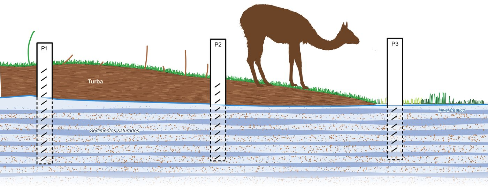
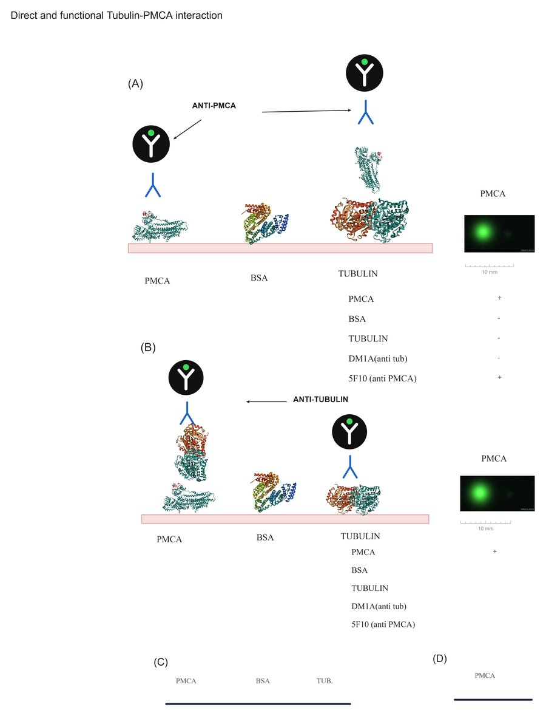
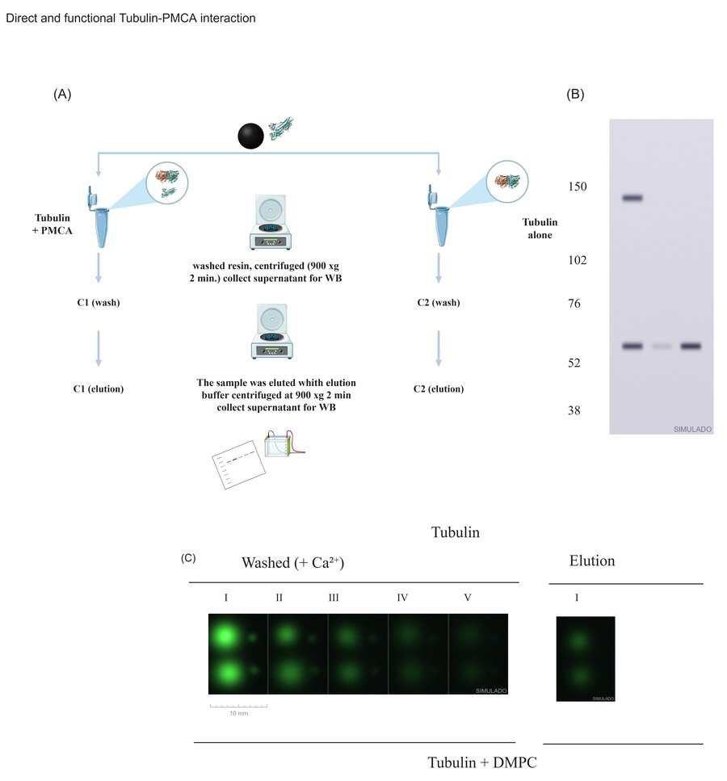

# BioFig 🧬🌿

**Editor local y gratuito de figuras científicas**, en la línea de BioRender, pensado para **ecología** y **biología molecular**.
Corre en tu computadora y se usa desde el navegador. Tiene más de 3000 iconos libres, estructuras 3D del Protein Data Bank,
quitado de fondos con IA local y generación de figuras a partir de texto (opcional, con tu propia clave de Gemini o DeepSeek).

> Proyecto personal en desarrollo. ¡Cualquier opinión o sugerencia es bienvenida!

| Perfil de un bofedal con pozos de monitoreo | Ensayo de superposición con estructuras del PDB | Esquema de pull-down |
|---|---|---|
|  |  |  |

*Figuras de ejemplo hechas con BioFig. Los blots son simulados y están marcados como tales.*

---

## Instalación

Requisitos: **Python 3.11 o más nuevo** y **Git**, más conexión a internet la primera vez.
- Windows: [python.org](https://www.python.org/downloads/) (marcá *Add python.exe to PATH*) y [git-scm.com](https://git-scm.com/downloads).
- Mac: `brew install python git`.
- Linux: los paquetes de tu distribución.

```bash
git clone https://github.com/kampax/biofig.git
cd biofig
```

Después:

| Sistema | Cómo abrirlo |
|---|---|
| **Windows** | Doble clic en **`iniciar.bat`** |
| **Mac / Linux** | `./iniciar.sh` |

**La primera vez se instala todo solo** con `instalar.py`, y tarda unos minutos:
1. Verifica Python y Git.
2. Crea un entorno virtual aislado (`.venv`); no toca tu Python.
3. Instala las dependencias, incluida rembg para quitar fondos.
4. Descarga las bibliotecas de iconos libres (~620 MB), fijadas a una versión exacta.
5. Construye el índice de la biblioteca.
6. Crea tres figuras de ejemplo.

Las veces siguientes abre directamente **http://127.0.0.1:8765**. Para apagarlo, cerrá la ventana de la consola (o Ctrl+C).

Opciones del instalador (se puede ejecutar de nuevo cuando quieras):

```bash
python instalar.py --sin-rembg     # sin "quitar fondo" (ahorra ~400 MB de dependencias)
python instalar.py --sin-ejemplos  # sin las figuras de ejemplo
```

---

## Qué se puede hacer

### Editor
- Lienzo con mover, escalar, rotar, espejar, capas, alinear y distribuir, selección múltiple, deshacer/rehacer, copiar/pegar, zoom y cuadrícula con imán.
- **Conectores** de activación, inhibición (T), indirecto, reversible y catálisis. Se curvan y **quedan pegados a los iconos**: si movés un icono, sus flechas y su etiqueta lo siguen.
- Textos con contorno blanco opcional, para que se lean sobre las flechas.
- **Tinte**: recolorear cualquier icono.
- **Exportar** a PNG (×1, ×3, fondo transparente), JPG o archivo `.biofig.json`. Los proyectos se guardan en `data/projects/`.
- **Créditos automáticos**: arma el texto de atribución de los iconos con licencia CC BY, listo para la leyenda.

### Biblioteca de iconos (~3100, todos de uso libre)
Filtros al estilo BioRender: **Ecología, Molecular, Celular, Laboratorio y objetos, Agricultura, Membranas, Gráficos y símbolos, Satélite y ★ Mis iconos**. La búsqueda acepta español o inglés ("zorro", "ribosoma", "bicapa", "dron").

| Fuente | Qué aporta | Licencia |
|---|---|---|
| [Bioicons](https://bioicons.com) | ~2550 iconos de biología, laboratorio y anatomía (incluye Servier) | CC0 / CC BY / MIT según el icono |
| [Fluent Emoji](https://github.com/microsoft/fluentui-emoji) (Microsoft) | ~300 objetos, cultivos, animales de granja, clima, satélites | MIT |
| [Health Icons](https://healthicons.org) | Equipo médico y de laboratorio, gráficos | CC0 |
| [PhyloPic](https://www.phylopic.org) (en línea) | Miles de siluetas de organismos; busca también por nombre común | CC0 / CC BY / CC BY-SA |
| Propios de BioFig | Membranas, gráficos científicos, satélites y teledetección, equipo de campo, paisajes, proteínas | Libres |

### Estructuras 3D (Protein Data Bank)
Formas → **🧬 Abrir visor 3D**:
- Cargás cualquier código PDB, rotás con el mouse y elegís representación (cintas, superficie, esferas, varillas), colores (por cadena, arcoíris N→C, estructura secundaria), cadenas y ligandos.
- La insertás en alta resolución con fondo transparente. Después se puede **reorientar** desde Propiedades.
- Opcional: **📏 Ajustar a tamaño real** pone todas las proteínas de la figura a la misma escala en Å.

### Iconos personalizados y quitar fondo
Iconos → **＋ Icono personalizado**:
- Subís una imagen o un SVG y queda en **★ Mis iconos**.
- Opcionalmente le **quitás el fondo** con [rembg](https://github.com/danielgatis/rembg). Corre **en tu computadora**, sin claves ni servicios externos.
- A una foto ya insertada también se le puede quitar el fondo desde Propiedades.

### Imágenes propias
Blots, fotos, microscopía: arrastrá el archivo al lienzo, pegalo con Ctrl+V o usá Formas → *Insertar imagen*.

### Generar figuras con IA (opcional)
Pestaña **IA ✨**:
1. Elegís **Gemini** ([clave gratuita con límites](https://aistudio.google.com/apikey)) o **DeepSeek** ([platform.deepseek.com](https://platform.deepseek.com/api_keys)).
2. Pegás la clave. Se verifica y se guarda **solo** en `.env` de tu computadora, que nunca se sube a Git.
3. Describís la figura ("red trófica de un bosque…", "vía MAPK…").

La IA arma un borrador con compartimentos, iconos y flechas, que después editás. Es la **única** función que usa una clave.

| Función | ¿Clave? | ¿Internet? |
|---|---|---|
| Generar figura con IA | Sí (Gemini o DeepSeek) | Sí |
| Siluetas de PhyloPic, estructuras del PDB | No | Sí (gratis) |
| Quitar fondo (rembg) | No | Solo para bajar el modelo la primera vez |
| Editor, biblioteca, exportar | No | No |

---

## Estructura del proyecto

```
biofig/
├── iniciar.bat / iniciar.sh   # abrir BioFig (instala la primera vez)
├── instalar.py                # instalador idempotente
├── server.py                  # servidor (FastAPI): API, archivos, IA
├── phylopic.py                # búsqueda de siluetas en PhyloPic
├── bgremove.py                # quitar fondo con rembg
├── build_index.py             # arma data/icons.json a partir de todas las fuentes
├── fuentes_extra.py           # selección curada de Fluent Emoji y Health Icons
├── make_builtin.py            # genera los iconos propios básicos
├── make_extra_icons.py        # genera membranas, gráficos, satélites, campo y agro
├── static/                    # la aplicación web (HTML, JS, CSS) y los iconos propios
│   ├── app.js                 # editor
│   ├── pdb3d.js               # visor 3D del PDB
│   ├── custom_icons.js        # iconos personalizados y quitar fondo
│   ├── builtin/ extra/        # iconos SVG propios
│   ├── pdb/                   # estructuras de los ejemplos
│   └── vendor/                # Konva y 3Dmol.js
├── ejemplos/                  # scripts que generan las figuras de ejemplo
├── docs/                      # documentación e imágenes
└── data/                      # (local) proyectos, Mis iconos, cachés
```

Detalles técnicos (API, formato de los proyectos, cómo agregar fuentes de iconos): [docs/ARQUITECTURA.md](docs/ARQUITECTURA.md).

---

## Problemas frecuentes

| Problema | Solución |
|---|---|
| "No se encontró Python" | Instalá Python 3.11+ y marcá *Add python.exe to PATH*; volvé a abrir `iniciar.bat`. |
| Falló la descarga de bibliotecas | Revisá la conexión y ejecutá `python instalar.py` de nuevo: retoma donde quedó. |
| El visor 3D dice "servidor desactualizado" | Cerrá la ventana de BioFig y volvé a abrir `iniciar.bat`. |
| La IA responde 401/403 | La clave es inválida o venció: cargala de nuevo en la pestaña IA. |
| El puerto 8765 está ocupado | Ya hay un BioFig abierto; usá esa ventana o cerrala. Otra opción: `BIOFIG_PORT=8800`. |
| Reinstalar todo desde cero | Borrá `.venv`, `vendor_src` y `.instalado`, y abrí `iniciar.bat`. |

---

## Licencias y créditos

BioFig usa recursos de terceros, cada uno con su licencia: ver [THIRD_PARTY_NOTICES.md](THIRD_PARTY_NOTICES.md).
Al publicar una figura, usá el botón **Créditos**: genera el texto de atribución de los iconos que lo requieren.
Si usás estructuras del PDB, citá el trabajo original de cada entrada.
